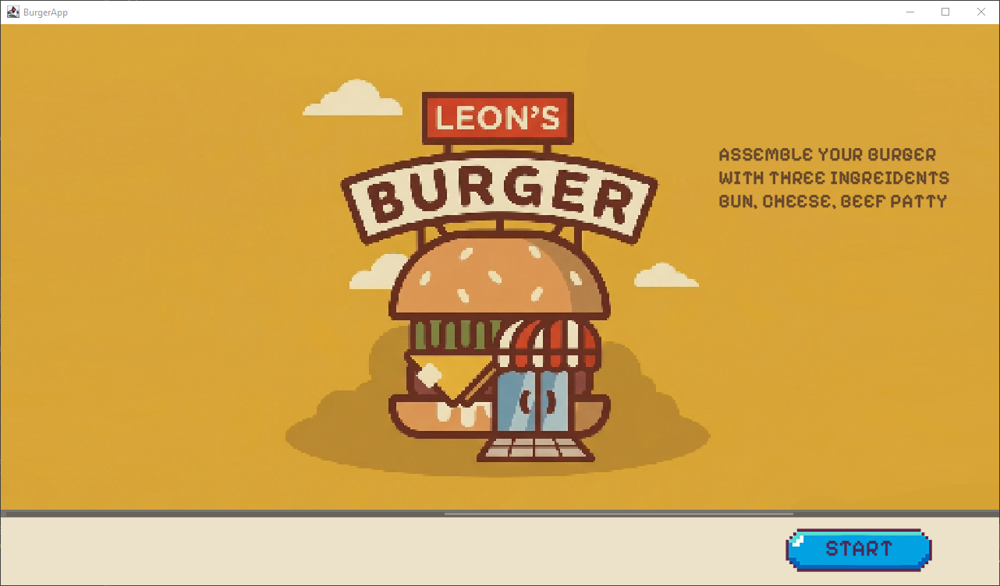
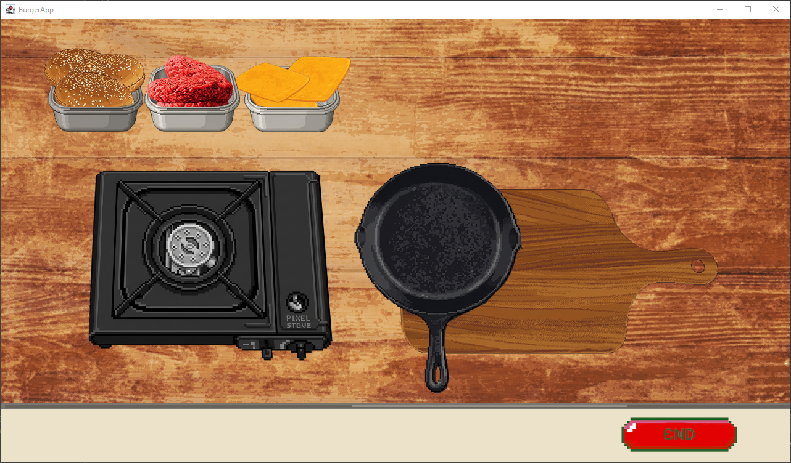
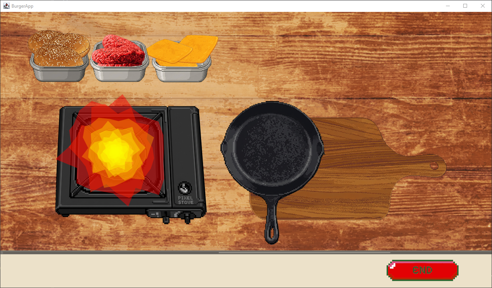
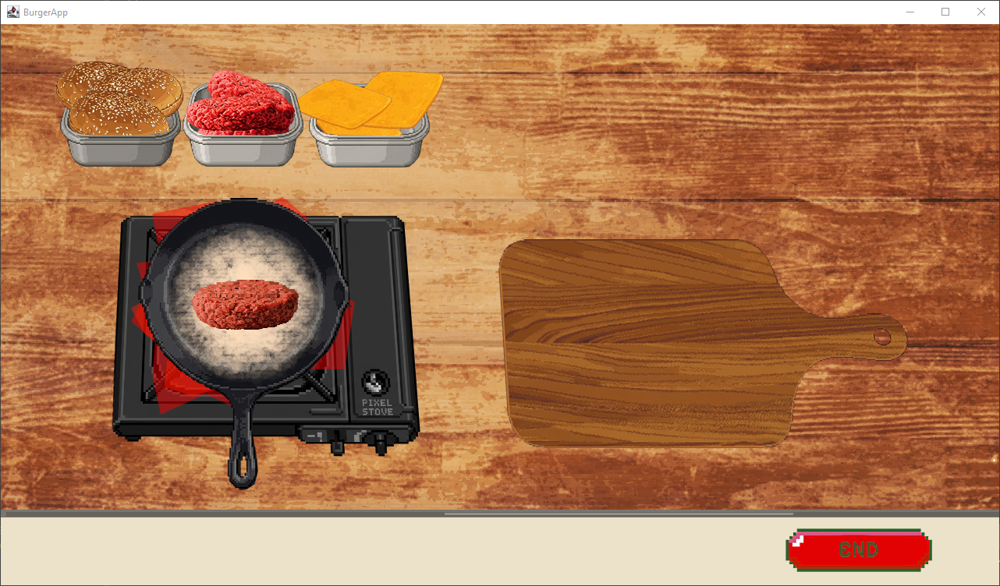
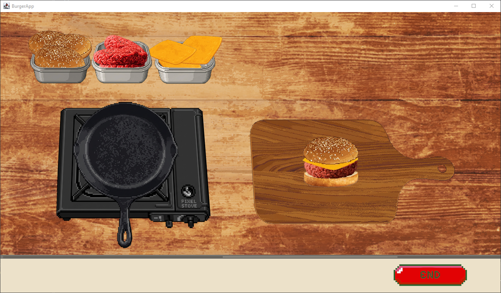
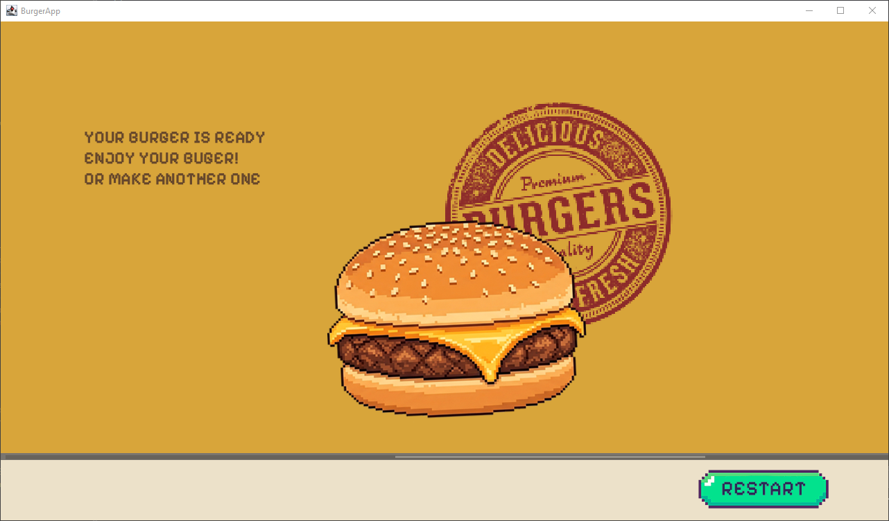

# Burger Simulation

This is a Java-based burger-making simulation project containing source code, assets, and libraries needed to build and run the simulation.

## Summary

- Project files are in the `burger-simulation` subfolder.
- A prebuilt Windows version (`BurgerSimulation.exe`) is in `burger-simulation/dist/BurgerSimulation/`.
- Key folders:
  - `src/assets/` — images & sound files used by the app (png, wav, fonts).
  - `src/button/`, `src/main/`, `src/fx/`, `src/sound/`, `src/util/` — Java packages with source code.
  - `src/lib/` — third-party JARs required at runtime (core.jar, minim, mp3spi, tritonus, etc.).
  - `.classpath`, `.project`, `.settings/` — Eclipse project metadata.

## Screenshots

The game flow, in order (left to right, top to bottom):

<table>
  <tr>
    <td align="center"> 1. Start screen</td>
    <td align="center"> 2. Kitchen</td>
  </tr>
  <tr>
    <td align="center"> 3. Stove on</td>
    <td align="center"> 4. Cooking the patty</td>
  </tr>
  <tr>
    <td align="center"> 5. Assembling</td>
    <td align="center"> 6. Result</td>
  </tr>
</table>

## Download (Windows)

A ready-to-run Windows build is in [`burger-simulation/dist/BurgerSimulation/`](burger-simulation/dist/BurgerSimulation/). Keep the whole folder together and double-click `BurgerSimulation.exe` (Java must be installed). The launcher starts `burger.jar` and loads the libraries in `lib/` and the images and sounds in `src/assets/` using relative paths, so do not move them apart.

## Requirements

- Java JDK (8 or newer recommended).
- No build system is included; project is set up for Eclipse/IDE usage.

## Recommended: Open in an IDE (Eclipse / IntelliJ)

1. Open your IDE and choose "Import > Existing project" (Eclipse) or "Open" (IntelliJ).
2. If required, add all JARs from `src/lib/` to the project's classpath/module dependencies.
3. Run the main application class: `BurgerApp` (found in `src/main/`).

## Quick command-line (example)

From the `burger-simulation` project folder (adjust paths if necessary):

- Compile (example, Windows PowerShell/CMD):
  javac -cp "src\lib\*;" -d out src\\**\\*.java

- Run (example):
  java -cp "out;src\lib\*" BurgerApp

Note: If the source files use package declarations, include the package-qualified main class name when running (e.g., `com.example.BurgerApp`). Using an IDE is simpler.

## Notes

- Audio playback uses third-party audio libraries in `src/lib/` (Minim/tritonus). Ensure those JARs are present on the runtime classpath.
- Assets are loaded from `src/assets/`. Run the app from the project root or configure your IDE so the working directory includes the `src/assets` path.

## Licensing

Apache-2.0 license
